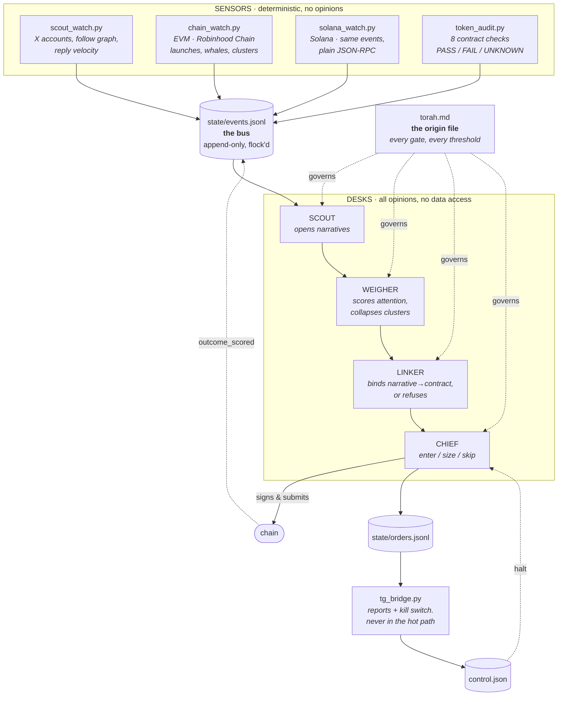
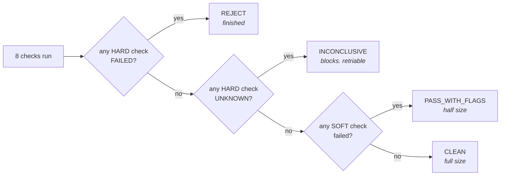

<div align="center">

<picture>
  <source media="(prefers-color-scheme: dark)" srcset="docs/img/banner-dark.png">
  <source media="(prefers-color-scheme: light)" srcset="docs/img/banner.png">
  
</picture>

**An AI trading brain that reads attention on X before it reaches the chart.**

Four deterministic sensors, four reasoning desks, one append-only log between them.
The opinions live in a markdown file you can read and argue with.

</div>

---

> ### ⚠️ This repository is incomplete and still being updated
>
> The sensors, the audit suite and the control plane are real, typed, linted and
> tested. What is **not** here yet:
>
> - the **agent runtime** — the glue that tails the bus, builds context and calls a model. The four desks ship as role specs, not running processes.
> - the **lesson loader** — the format is stable and documented; the reader is not written.
> - the **brain map viewer** — the 3D lesson visualiser is a sketch and is deliberately out of this repo until it is worth your time.
>
> Treat this as a working skeleton and a design document, not a product you can
> `pip install` and point at a wallet. Issues and PRs welcome. Star it if you
> want to know when the runtime lands.

---

## The idea

Price is a lagging indicator of attention. By the time a chart moves, the thing
that caused it to move already happened somewhere else — usually on X, usually
among a few dozen accounts, usually a while earlier.

So the question this system exists to answer is not *"what is pumping?"* It is:

> **Is anyone who matters paying attention to this, and did they start recently?**

Almost all of the engineering here is in refusing to answer yes. Mention volume
is the cheapest thing on the internet to manufacture, so a system that counts
mentions is measuring a budget, not an opinion. The work is in collapsing
coordination, discarding endorsements with no object, and ignoring the other
99-point-something percent.

```
observed  ████████████████████████████████████████████████  717,000
scored    █                                                  12,715   1.77%
entered   ▏                                                   1,824   0.25%
```

Those are the proportions from one deployment over two chains. The exact figures
are not the point and yours will differ — the **shape** is the point. If your
funnel does not look roughly like this, you are not running a filter, you are
running a firehose with extra steps.

---

## Architecture

Nothing imports anything else. No process calls another's functions. One
append-only file in, one append-only file out, one control flag — that is the
entire integration surface, and it is why a dead Telegram API or a throttled RPC
cannot take the system down with it.



The arrows between desks are not function calls. Every desk reads from the same
log and writes back to it; the order shown is the order evidence tends to
accumulate in, not a pipeline anyone enforces.

### Why the split is the whole design

|  | sees | decides | can be wrong about |
|---|---|---|---|
| `scout_watch.py` | X accounts | nothing | nothing — it diffs lists |
| `chain_watch.py` | Robinhood Chain | nothing | nothing — it reads logs |
| `solana_watch.py` | Solana | nothing | nothing — it diffs balances |
| `token_audit.py` | contracts | nothing | nothing — checks return a verdict |
| **SCOUT** | events | what is worth opening | which narratives matter |
| **WEIGHER** | narratives | what attention is real | how much a mention is worth |
| **LINKER** | narratives + contracts | which token is *the* token | identity |
| **CHIEF** | everything | enter / size / skip | the trade |

An agent asked to do a deterministic job will invent one. A deterministic module
asked to hold an opinion will encode yesterday's opinion forever. Keep the line
where it is.

---

## The gate that matters most

Every contract check returns `PASS`, `FAIL` or `UNKNOWN`, and the single most
important rule in the system is what happens to `UNKNOWN`.



**`UNKNOWN` is never `PASS`.** If an RPC call timed out, the check did not pass —
it did not run. A system that quietly promotes *"I could not check"* into
*"looks fine"* will eventually buy the one token it could not read, and that is
the one that rugs.

This is one line of code and it is the difference between a filter and a
liability.

---

## The origin file

[`torah.md`](torah.md) is the brain. Everything else is plumbing.

The Python holds no opinions. Every threshold, every gate, the sizing bands, the
exit ladder and the definition of a lesson live in that one markdown file, in
plain language, where you can read it, disagree with it and change it without
touching code.

Two readers consume it:

| Reader | Reads | How |
|---|---|---|
| `tg_bridge.py` | the ```yaml``` `execution` block | parsed as YAML |
| the four desks | everything else | passed in as system context |

**The file as shipped is a starting point, not a recommendation.** The market-cap
band is deliberately left for you to define — inheriting someone else's clock is
the fastest way to be consistently late.

---

## Lessons

[`lessons/`](lessons/) is the brain's memory: one falsifiable rule per line.

A lesson qualifies only if it is falsifiable, would have changed a decision,
is not already in the file, and survives a counterfactual. Rule three is the one
that breaks, and it breaks quietly:

> A brain that holds the same lesson forty times has not learned it forty times.
> It has one lesson and a counting bug — and every duplicate pulls on decisions
> as if it were independent evidence.

[`lessons/fingerprint.py`](lessons/fingerprint.py) audits for this with no API
key and no model, so it runs in CI:

```bash
python lessons/fingerprint.py --check lessons/example.lessons.jsonl
```

```
EXACT    6235766a533d4a40: b-0003, b-0051 — merge these
NEAR     0.62  b-0003 / b-0099 — likely the same lesson
CONFLICT b-0012 / b-0044 — same rule, different magnitude. Do not merge;
                           one of these is miscalibrated
```

Exact hashing catches copy-paste. Jaccard similarity catches the case that
actually happens — the same rule rewritten weeks later in different words.
Calibration conflicts are reported separately and never merged, because
"reject above 6 holders" and "reject above 600 holders" are not duplicates;
they are one rule calibrated two ways and one of them is wrong.

The repo ships **eight example lessons and no real ones.** They demonstrate the
format. Copying them into production means running someone else's conclusions
on your own money.

---

## Quickstart

```bash
git clone https://github.com/0xFrogify/BLASTRA.git && cd BLASTRA
python -m venv .venv && source .venv/bin/activate
pip install -e ".[dev]"

cp .env.example .env     # then fill it in
export BLOB_ROOT="$PWD/run"
```

Two things run standalone, with no agent runtime and no API keys:

```bash
python solana_watch.py --selftest          # live check against Solana mainnet
python token_audit.py 0xYourTokenAddress   # 8 checks and a verdict
```

## Verifying it actually works

This matters more than usual here, so it gets its own section.

```bash
pytest          # 41 tests, no network required
ruff check .    # lint
mypy            # types on the annotated modules
```

The test suite covers the **pure** half of the sensors — every function that
turns an RPC response into a decision, which is where the bugs that cost money
live. Transfers parsed from a balance diff, launches distinguished from buys,
failed transactions rejected, whale thresholds at the boundary, market cap from
curve reserves, band crossings staying monotonic, funding-root resolution, and
every one of those functions fed deliberately malformed input to prove it
degrades to "no information" instead of crashing the loop.

The suite is mutation-tested. Break the supply guard, delete the failed-transaction
check, flip the whale comparison to `>`, make `mcap_sol` return `0.0` instead of
`None`, let crossed bands re-emit, or stop treating an unknown funder as
disqualifying — each one turns a test red. Tests that pass no matter what the
code does are decoration.

**What the tests do not cover is the transport**, because they run with no
network by design. That is what `--selftest` is for:

```
$ python solana_watch.py --selftest
endpoint: https://api.mainnet-beta.solana.com

  PASS  getHealth  (412ms)
  PASS  getSlot  (118ms)
        current slot 301284771
  PASS  getSignaturesForAddress(6EF8rrec…)  (203ms)
        5 recent signatures
  PASS  getTransaction(most recent)  (331ms)
        parsed 4 balance change(s), 3 program(s)

selftest PASSED
```

It also catches the single most likely configuration error: if
`SOL_LAUNCH_PROGRAM` is wrong, the launch program will be absent from its own
transaction, and the selftest says so instead of silently watching nothing.

### Configuration

| Variable | Default | Used by |
|---|---|---|
| `BLOB_ROOT` | `/oracle` | everything — where `state/`, `control.json` and `torah.md` live |
| `RHC_RPC` | public Robinhood Chain RPC | `chain_watch`, `token_audit` |
| `RHC_BLOCKSCOUT` | public Blockscout API | `chain_watch` |
| `SOL_RPC` | public mainnet-beta | `solana_watch` |
| `SOL_LAUNCH_PROGRAM` | pump.fun program id | `solana_watch` |
| `SOL_AMM_PROGRAM` | PumpSwap program id | `solana_watch` |
| `SOL_WHALE_FRACTION` | `0.015` | `solana_watch` |
| `SOL_MCAP_BANDS` | `50,100,…` (SOL) | `solana_watch` |
| `PONS_FACTORY` | — | `chain_watch`, `token_audit` |
| `PONS_CODEHASHES` | — | `token_audit` |
| `TG_BOT_TOKEN` | — | `tg_bridge` — a bot token, never a user session |
| `TG_CHAT_ID` | — | `tg_bridge` |

The public RPC is free and keyless but shared and rate limited. Fine to
prototype; swap in a provider before you poll every block. Only the URL changes.

---

## What this is not

- **Not financial advice, and not a strategy.** It is an architecture for
  deciding *not* to trade, most of the time.
- **Not a sniper.** On a chain with first-come-first-served ordering and
  `eth_maxPriorityFeePerGas` returning zero there is no gas auction. You cannot
  outbid, only arrive earlier, and arriving earlier costs you the opening tax.
- **Not a wallet-to-X deanonymiser.** That link is not public. An agent asked to
  guess it will invent one and it will read as a fact downstream. The code
  refuses to make the claim.
- **Not a backtest.** Nothing here replays history.

Run it on money you are prepared to lose, or on nothing at all.

---

## Repository layout

```
torah.md                  the origin file — every gate and threshold
bus.py                    the entire integration surface, 72 lines
scout_watch.py            X sensor: watchlist tiering, follow diffs, velocity
chain_watch.py            EVM sensor: launches, whales, funding clusters
solana_watch.py           Solana sensor: same events, plain JSON-RPC, typed
token_audit.py            8 contract checks → CLEAN / FLAGS / INCONCLUSIVE / REJECT
tg_bridge.py              reporting + approvals + kill switch
agents/                   the four desks, as model-agnostic role specs
lessons/                  lesson schema, dedup audit, 8 examples
tests/                    41 tests over the parsing and decision logic
```

## Contributing

The most useful PR right now is the agent runtime — forty-odd lines that tail
the bus, assemble context from `torah.md` plus a role spec plus recent events,
call a model and emit. It is deliberately unwritten rather than written badly,
and it should stay provider-agnostic.

## Credits

Built by [**@0xFrogify**](https://github.com/0xFrogify).

Engineering contributions by **Claude** (Anthropic) — the Solana sensor, the
test suite, the lesson deduplication audit, and the project tooling.

## License

MIT. See [LICENSE](LICENSE).
